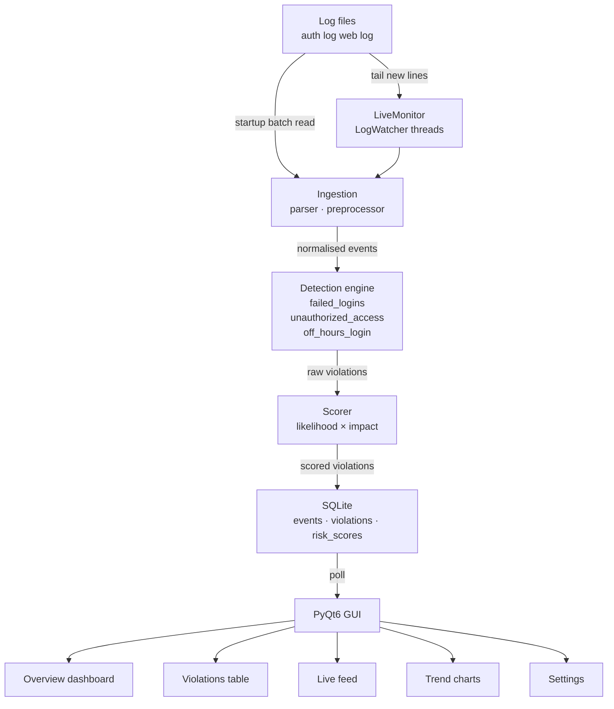
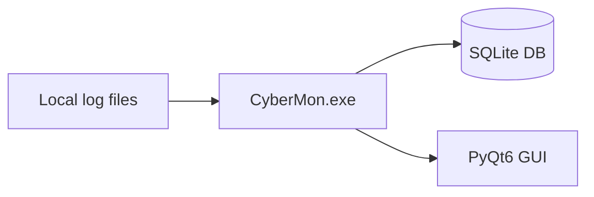
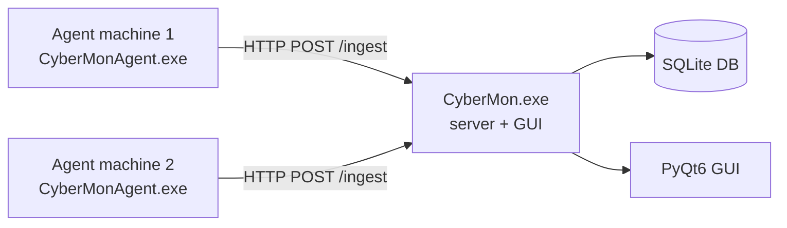

# CyberMon v2.0

> A native desktop cybersecurity monitoring application for Windows.  
> Ingests SSH authentication logs (Linux syslog and Windows OpenSSH) and Apache logs, detects three classes of policy violation, scores each by risk, and surfaces everything in a live PyQt6 GUI — no browser required.

---

## What it does

CyberMon watches your log files in real time. When a suspicious pattern appears — a brute-force SSH attempt, a probe of a restricted URL, or a successful login at 3 AM — it detects the violation, scores it on a 1–25 likelihood × impact scale, persists it to a local SQLite database, and displays it in the desktop interface within a few seconds. No page refresh. No browser.

It ships as a standalone `.exe`. No Python installation required on the target machine.

---

## How it works



On launch CyberMon:

1. **Prepares the database** — creates the schema and, if `storage.clear_on_start` is `true`, empties the `events`, `violations` and `risk_scores` tables so the session reflects the log files as they are now.
2. **Runs a full batch pass** over both configured log files — unless `pipeline.run_on_launch` is `false`, in which case only new lines are analysed.
3. **Starts live monitoring** — a `LiveMonitor` keeps two background `LogWatcher` threads tailing both files. Each new line is parsed, persisted, run through detection and scoring, and written to the database.
4. **Opens the window.** The panels poll the database, so new violations show up in the Live Feed and Overview within about 3 seconds.

Changing a log path in **Settings** switches live monitoring to the new files immediately — no restart needed.

### Supported log formats

| Log | Formats |
|-----|---------|
| Auth log | Linux syslog `sshd` lines (`Failed password`, `Accepted password`, `Invalid user`) and Windows OpenSSH file logs |
| Web log | Apache combined access log; Apache error log (access-denied / forbidden entries are treated as HTTP 403) |

---

## Detection rules

| Rule | What triggers it | Configurable |
|------|-----------------|--------------|
| **Failed logins** | More than `threshold` failed SSH logins for the same user within a rolling time window. The startup batch pass also flags **password spraying**: one source IP failing against `threshold` or more distinct usernames inside the window. | threshold, window (minutes) |
| **Unauthorized access** | An HTTP response whose status is in `trigger_codes` (default 401, 403) on a restricted path. Matching is by path prefix with the query string stripped — `/admin` catches `/admin/login.php` and `/admin?page=1`, but not `/administrator`. | resource list, status codes |
| **Off-hours login** | A successful SSH login on a non-business day, or outside business hours (start inclusive, end exclusive). | days, start time, end time |

Rules live in `src/detection/`. The same prefix matcher (`src/detection/matching.py`) is used by both detection and scoring, so a sub-path is always scored like its parent.

The live watcher keeps a rolling count per `host:username` and suppresses repeat alerts for the same burst, so a 100-attempt brute force produces one clear violation instead of ~98 duplicates.

---

## Risk scoring

Every violation is scored as **Likelihood × Impact** (each 1–5), producing a score from 1 to 25 mapped to four severity tiers:

| Score | Severity | Colour |
|-------|----------|--------|
| 1 – 4 | Low | Green |
| 5 – 9 | Medium | Amber |
| 10 – 16 | High | Red |
| 17 – 25 | Critical | Dark red |

How each input is chosen (default values):

| Violation | Likelihood | Impact |
|-----------|-----------|--------|
| Failed logins | Banded by attempt count: ≤5 → 2, ≤9 → 3, ≤19 → 4, more → 5 | 4 for a high-impact user (`root`, `admin`), otherwise 2 |
| Unauthorized access | 3 | 5 for a high-impact path (`/admin`, `/.env`, `/phpmyadmin`), 3 for a medium path (`/config`, `/wp-admin`), otherwise 2 |
| Off-hours login | 2 | 5 for a high-impact user, otherwise 3 |

Every value above — tier boundaries, likelihood bands, impact values, and the high-impact user/path lists — lives in `config/config.yaml` under `scoring` and can be edited from the **Settings** panel. Nothing is hardcoded.

---

## GUI panels

CyberMon has five panels accessible from the sidebar.

### Overview

```
┌─────────────────────────────────────────────────────────┐
│  Total        Critical     High        Medium     Low   │
│  ┌──────┐    ┌──────┐    ┌──────┐    ┌──────┐  ┌─────┐ │
│  │  13  │    │   1  │    │   6  │    │   4  │  │  2  │ │
│  └──────┘    └──────┘    └──────┘    └──────┘  └─────┘ │
│                                                         │
│  By type                    ┌──── Severity split ────┐  │
│  Failed logins    ████░░░   │        ╭───╮           │  │
│  Unauth access    ██░░░░░   │     ╭──╯   ╰──╮        │  │
│  Off-hours        █░░░░░░   │    ─╯          ╰─       │  │
│                             └───────────────────────┘  │
└─────────────────────────────────────────────────────────┘
```

Five metric cards (Total / Critical / High / Medium / Low), per-type breakdown bars, and a doughnut chart of the severity distribution. Host filter and Refresh button. Refreshes automatically every 3 seconds.

### Violations table

```
┌──────────┬────────────┬─────────────────────┬─────────────┬──────────────────┬────────────────────┐
│ Severity │ Risk Score │ Violation Type      │ Source Host │ Timestamp        │ Recommended Action │
├──────────┼────────────┼─────────────────────┼─────────────┼──────────────────┼────────────────────┤
│ Critical │     20     │ failed_logins       │ srv-01      │ 2026-06-08 02:14 │ Immediate invest…  │
│ High     │     15     │ unauthorized_access │ srv-01      │ 2026-06-08 01:55 │ Investigate prom…  │
│ Medium   │      6     │ off_hours_login     │ srv-01      │ 2026-06-07 23:40 │ Review and inves…  │
└──────────┴────────────┴─────────────────────┴─────────────┴──────────────────┴────────────────────┘
```

A **Sort** control orders violations by risk for triage — *Highest risk first* (default), *Highest risk, oldest*, *Lowest risk first*, or *Newest first* — and column headers can be clicked to sort too. Host filter, Export CSV, and automatic refresh every 5 seconds. The recommended action is set by severity (from "Log and monitor" for Low up to "Immediate investigation and escalation" for Critical). Click any row to open the detail dialog: score breakdown (L × I), violation details, the raw log line that triggered it, the recommended action, and an **Export to Clipboard** button.

### Live feed

New violations appear as cards at the top of the feed as they are detected — no manual refresh needed. Each card shows a severity badge, violation type, source host and time, and the feed updates every 3 seconds. **Pause / Resume** freezes the view while detection carries on in the background; **Clear** resets the view.

### Trend charts

Two tabs:
- **Today by Hour** — all three violation types across today's 24 hours
- **Last 7 Days** — daily totals for the past week

Built with PyQtGraph. Three colour-coded series: failed logins (purple), unauthorized access (red), off-hours logins (amber). Refreshes every 5 seconds.

### Settings

| Section | What it controls |
|---------|-----------------|
| Log file paths | Auth and web log paths, with Browse buttons |
| Business hours | Start/end time and business days |
| Brute force detection | Failed-attempt threshold and time window |
| Risk scoring rules | High-impact users, high- and medium-impact paths |
| Score values (1–5) | Likelihood and impact values for each rule |
| Severity tier boundaries | Low / Medium / High / Critical score ranges (validated to cover 1–25 with no gaps or overlaps) |
| Restore defaults | Reset scoring values or detection rules from `config_default.yaml` — each touches only its own section |
| Appearance | Light / Dark theme, applied instantly |

Two save buttons:

- **Save changes** writes `config/config.yaml`. Log path changes take effect immediately; detection and scoring changes are applied on the next launch.
- **Save & Re-score** also recalculates the scores of every violation already in the database using the new scoring values, so the dashboard reflects them instantly.

Every save is validated first (invalid input writes nothing) and written atomically, keeping the previous file as `config.yaml.prev`. The theme choice is stored as a per-user UI preference (Qt `QSettings`), not in `config.yaml`. **Re-run Setup Wizard** shows the wizard again on the next launch.

---

## Dual mode

CyberMon supports two deployment configurations set in `config/config.yaml`:

```yaml
mode: standalone   # single machine — reads local log files directly
mode: network      # central server + remote agents
```

### Standalone mode



One machine. CyberMon reads its own log files. Suitable for a single server or a developer workstation.

### Network mode



Remote machines run `CyberMonAgent.exe` (console app, visible terminal). Each agent tails its local log file and POSTs new lines to the server on port 5001. The server runs the full detection → scoring → storage pipeline on each batch and tags each record with the originating `source_host`. All violations from all agents are visible in the single central GUI.

Failed-login detection on the server is stateful: it counts failures already stored in the database for the same user and host within the window, so a slow brute force spread across many small batches is still caught.

**Security.** Every request must carry an `X-API-Key` header matching `server.api_key`; anything else gets HTTP 401. Request bodies are capped at 2 MB and 5,000 lines, and host IDs are validated. An agent that receives a 401 stops immediately with a clear error instead of retrying. Change the default `CHANGE_ME_BEFORE_DEPLOY` key before deploying.

---

## Quick start — pre-built exe

1. Extract the release and double-click **`CyberMon.exe`** — the setup wizard opens.
2. Choose **Just this computer** (standalone) or **Monitor multiple computers** (network).
3. Point the wizard at your log files (or set the server address) and set your business hours.
4. Click **Finish** — the main dashboard opens and begins monitoring.

On subsequent launches the wizard is skipped and the dashboard opens directly. `config/`, `data/` and `cybermon.log` are created next to the exe.

> **No Python installation required.** The exe is fully self-contained.

---

## Quick start — from source

```bat
git clone https://github.com/Mak-beth/Cybermon.git
cd Cybermon

py -m venv venv
venv\Scripts\activate
pip install -r requirements.txt

venv\Scripts\python.exe main.py
```

Or run **`start.bat`**, which creates the virtual environment if needed, installs the requirements and starts the app.

The setup wizard will appear on the first run. To skip it in development, ensure `config/config.yaml` contains `setup_complete: true`.

`--auth-log PATH` and `--web-log PATH` override the configured log paths for that run.

To simulate attack traffic in a second terminal while the app is running:

```bat
venv\Scripts\python.exe simulate.py
```

This appends synthetic log lines (covering all four severity tiers) to the configured log paths. New violations appear in the Live Feed within a few seconds.

---

## Startup behaviour and persistence

Two config keys control what happens at launch:

| `storage.clear_on_start` | `pipeline.run_on_launch` | Result |
|---|---|---|
| `true` (default) | `true` (default) | Fresh rebuild: both log files analysed in full, then continuous live monitoring |
| `true` | `false` | Clean live-only session: the dashboard fills as new activity arrives |
| `false` | `true` | Findings accumulate across sessions, with a full analysis on every launch |
| `false` | `false` | Previous findings kept; monitoring continues with new activity |

---

## Demo mode

For a live presentation, run `scripts/demo_feed.py` in a second terminal alongside the app to simulate continuous traffic:

```bat
venv\Scripts\python.exe scripts\demo_feed.py
venv\Scripts\python.exe scripts\demo_feed.py --seconds 60
```

It replays log lines into the live-monitored files (`logs/live/auth.log` and `logs/live/access.log`), rewriting each line's timestamp to the current time so the **Live Feed** and **Trend** panels show detection happening continuously. Sources are the real LogHub datasets in `logs/real/` plus the hand-written, labelled demo inputs in `logs/demo/` (which add off-hours logins). Picks are weighted 70/30 towards lines that will trigger a violation, and failed logins are fed in short bursts that rotate across usernames, so each burst registers as its own distinct violation. Press Ctrl+C to stop, or pass `--seconds N` for a bounded run.

Source files are opened read-only and their SHA-256 hashes are verified unchanged at the end of each run — the tool only appends to `logs/live/`. Start it once `python main.py` is running, with `auth_log_path` / `web_log_path` pointing at `logs/live/`. Setting `pipeline.run_on_launch: false` gives a clean, live-only demo.

---

## Running the agent (network mode)

On each remote machine, run:

```bat
CyberMonAgent.exe
CyberMonAgent.exe --config path\to\agent_config.yaml
```

On first launch it creates `agent_config.yaml` in the same directory with default values. Edit `server_ip`, `log_path`, `host_id` and `api_key`, then restart.

```yaml
server_ip: 192.168.1.10   # IP of the machine running CyberMon.exe
server_port: 5001
api_key: CHANGE_ME_BEFORE_DEPLOY   # must match server.api_key on the server
log_path: /var/log/auth.log
host_id: web-server-1
retry_attempts: 3
retry_delay_seconds: 2
```

The terminal window stays open and prints one status line per batch sent. See `RUNNING.md` for multi-agent setups.

---

## Architecture

```
cybermon/
├── main.py                     ← entry point: DB prep, startup pipeline, LiveMonitor, Qt app
├── agent_main.py               ← CyberMonAgent entry point (console, no Qt)
├── simulate.py                 ← writes synthetic attack lines to configured log paths
├── migrate_db.py               ← adds new columns to an older database without data loss
├── start.bat                   ← one-click dev launcher (venv + requirements + main.py)
├── config/
│   ├── config.yaml             ← writable user config (created by wizard)
│   └── config_default.yaml     ← factory defaults (bundled inside exe, read-only)
├── src/
│   ├── live_monitor.py         ← LiveMonitor: owns the watcher + DB callbacks, restart on new paths
│   ├── ingestion/
│   │   ├── parser.py           ← regex parsers: Linux + Windows OpenSSH auth, Apache access + error
│   │   ├── preprocessor.py     ← normalise to event dicts, timestamp handling
│   │   ├── reader.py           ← file reader
│   │   └── watcher.py          ← LogWatcher: tail threads, live detection, alert cooldown
│   ├── detection/
│   │   ├── detector.py         ← runs all three rules over a batch of events
│   │   ├── matching.py         ← shared restricted-path prefix matcher
│   │   └── rules/              ← failed_logins (incl. spray), unauthorized_access, off_hours
│   ├── scoring/
│   │   ├── rules.py            ← config-driven likelihood and impact
│   │   └── scorer.py           ← score = L × I, severity tier lookup
│   ├── storage/
│   │   ├── db.py               ← schema: events, violations, risk_scores
│   │   ├── writer.py           ← INSERT helpers + find_triggering_event_id()
│   │   ├── reader.py           ← summary and trend queries
│   │   └── rescore.py          ← scores-only recompute for Save & Re-score
│   ├── agent/
│   │   └── agent.py            ← CyberMonAgent: tail file, POST batches, retry, 401 fast-fail
│   └── gui/
│       ├── theme.py            ← single source of truth for Light / Dark palettes and stylesheet
│       ├── main_window.py      ← MainWindow: sidebar, panel stack, banners, live path reload
│       ├── overview_panel.py   ← 5 metric cards, doughnut chart, breakdown bars
│       ├── violations_table.py ← risk sort control, host filter, CSV export
│       ├── detail_panel.py     ← modal: score breakdown, raw log, recommended action
│       ├── live_feed.py        ← live violation cards, 3 s poll, pause/resume
│       ├── trend_panel.py      ← PyQtGraph line charts (hour / 7-day)
│       ├── settings_panel.py   ← config editor, scoring editor, Save & Re-score, theme
│       ├── config_io.py        ← validation and atomic config writes (Qt-free)
│       ├── wizard.py           ← setup wizard (mode → paths or server → confirm)
│       └── data_access.py      ← read-only GUI queries against SQLite
├── server/
│   └── ingest_endpoint.py      ← Flask POST /ingest (network mode, daemon thread)
├── assets/
│   └── icon.ico                ← purple shield icon
├── build/
│   ├── cybermon.spec           ← PyInstaller spec: CyberMon.exe (windowed, onefile)
│   ├── agent.spec              ← PyInstaller spec: CyberMonAgent.exe (console, onefile)
│   └── make_icon.py            ← regenerates assets/icon.ico from the QPainter shield
├── logs/
│   ├── samples/                ← small labelled sample logs (used by the test suite)
│   ├── real/                   ← real LogHub datasets (evaluation evidence, read-only)
│   ├── demo/                   ← hand-written demo inputs (labelled, not evidence)
│   └── live/                   ← files the app tails during demos
├── scripts/
│   ├── benchmark.py            ← pipeline performance benchmark (real LogHub data)
│   ├── demo_feed.py            ← presentation demo: replays logs into logs/live/
│   ├── tier_check.py           ← verifies simulate.py produces all four tiers
│   ├── gui_smoke.py            ← offscreen check that every panel constructs
│   └── endpoint_probe.py       ← manual probe of the network ingest endpoint
└── tests/                      ← 318 tests across 23 files
```

`RUNNING.md` has step-by-step run instructions for both modes; `PROJECT_TIMELINE.md` records the development history.

---

## Tech stack

| Technology | Version | Role |
|-----------|---------|------|
| Python | 3.12 | Core language |
| PyQt6 | ≥ 6.6 | Native desktop GUI, widgets, signals |
| PyQtGraph | ≥ 0.13 | Trend line charts |
| SQLite | stdlib | Local persistence (events, violations, scores) |
| PyYAML | — | Config loading and writing |
| pandas | — | Time-window sliding analysis in detection rules |
| Flask | — | Network mode ingest endpoint only (daemon thread, no browser) |
| requests | — | Agent HTTP POST with retry |
| PyInstaller | 6.x | Packages app + agent as standalone `.exe` files |
| pytest | — | Unit, integration and offscreen GUI tests |

---

## Test coverage

```
tests/test_settings_config_io.py      37 tests   config validation, atomic save, scoped restore
tests/test_scoring.py                 36 tests   likelihood, impact, severity bands, tiers
tests/test_storage.py                 31 tests   DB init, read, write, trend queries
tests/test_ingestion.py               27 tests   Linux/Windows/Apache parsing, normalisation
tests/test_detection.py               25 tests   all three rules, prefix match, spray
tests/test_live_monitor.py            15 tests   live path reload, thread restart, close handling
tests/test_run_on_launch.py           15 tests   startup gating, DB prep, clear_on_start
tests/test_watcher.py                 14 tests   log tailing, live detection, alert dedup
tests/test_ingest_endpoint.py         13 tests   POST /ingest, validation, slow brute force
tests/test_rescore.py                 11 tests   scores-only recompute, rollback
tests/test_offhours_impact.py         11 tests   privilege-aware off-hours impact
tests/test_violation_sort.py          10 tests   risk-based sort modes
tests/test_r11a_auth.py               10 tests   API key auth, payload limits, host validation
tests/test_agent.py                    9 tests   tail, POST structure, retry, 401 fast-fail
tests/test_app_identity.py             9 tests   Windows taskbar identity, app icon
tests/test_rescore_ui.py               8 tests   Save & Re-score button behaviour
tests/test_r11b_stateful_detection.py  7 tests   DB-window brute-force detection
tests/test_r11c_config_scoring.py      7 tests   config-driven scoring rules
tests/test_integration.py              7 tests   end-to-end pipeline
tests/test_r7.py                       6 tests   simulate.py tier patterns, config bounds
tests/test_clear_on_start.py           5 tests   startup table wipe flag
tests/test_wizard.py                   4 tests   wizard config writer, first-run detection
tests/test_r11e_accuracy.py            1 test    ground-truth accuracy, zero false positives
─────────────────────────────────────────────────
Total                                318 tests   all passing
```

Run the suite:

```bat
venv\Scripts\python.exe -m pytest tests/ -v
```

---

## Configuration reference

`config/config.yaml` is created by the setup wizard on first launch. All keys:

```yaml
mode: standalone                    # standalone | network
setup_complete: true                # false = show the setup wizard on next launch

ui:
  theme: light                      # initial theme only; the user's choice is saved in QSettings

detection:
  failed_logins:
    threshold: 2                    # violation when failures EXCEED this within the window
    time_window_minutes: 10
  unauthorized_access:
    restricted_resources:           # path prefixes that trigger on a listed status code
      - /admin
      - /wp-admin
      - /phpmyadmin
      - /config
      - /.env
    trigger_codes: [403, 401]
  off_hours_logins:
    business_days: [0, 1, 2, 3, 4]  # Mon=0 … Sun=6
    business_hours_start: "08:00"   # inclusive
    business_hours_end:   "18:00"   # exclusive

scoring:
  severity_tiers:
    low:      { min: 1,  max: 4  }
    medium:   { min: 5,  max: 9  }
    high:     { min: 10, max: 16 }
    critical: { min: 17, max: 25 }
  rules:                            # all scoring constants are configurable
    high_impact_users: [root, admin]
    high_impact_resources: [/admin, /.env, /phpmyadmin]
    med_impact_resources: [/config, /wp-admin]
    # ...likelihood bands and per-type impact values — see config_default.yaml

storage:
  db_path: data/cybermon.db
  clear_on_start: true              # empty the tables on every launch

pipeline:
  run_on_launch: true               # analyse both log files in full at startup; false = live tail only

server:                             # network mode only
  host: 0.0.0.0
  port: 5001
  api_key: "CHANGE_ME_BEFORE_DEPLOY"   # must match api_key in agent_config.yaml

agent:                              # reference values only — the agent reads agent_config.yaml
  server_ip: 127.0.0.1
  server_port: 5001
  log_path: logs/auth.log
  host_id: agent-machine-1
  retry_attempts: 3
  retry_delay_seconds: 2

auth_log_path: logs/auth.log
web_log_path:  logs/access.log
```

---

## Building the executables

```bat
venv\Scripts\pyinstaller.exe build\cybermon.spec --distpath dist --workpath build\work
venv\Scripts\pyinstaller.exe build\agent.spec    --distpath dist --workpath build\work
```

| File | Description |
|------|-------------|
| `dist\CyberMon.exe` | Main application — GUI, no console window, `assets\icon.ico` embedded |
| `dist\CyberMonAgent.exe` | Remote agent — console window, no GUI |

Both are single-file executables. `config_default.yaml` is bundled inside `CyberMon.exe` and copied out as `config\config.yaml` on first launch.
